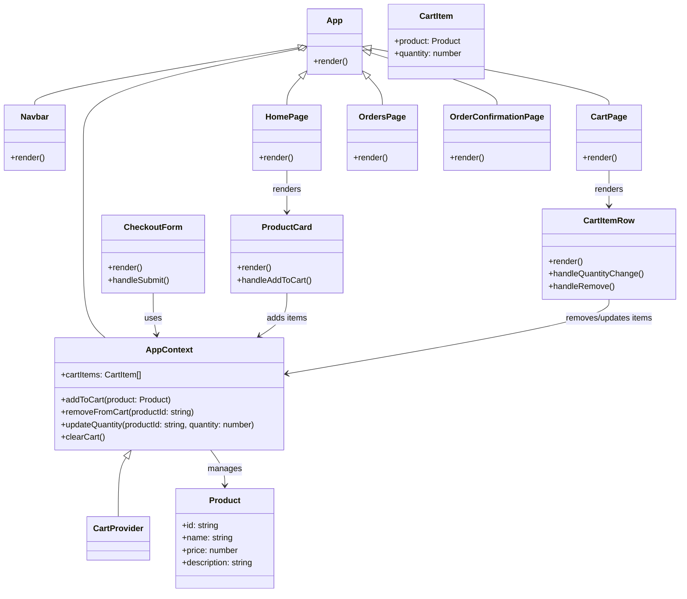

# UML Design for Ecommerce App

This document describes the main application structure and relationships using UML-style diagrams and component descriptions.

## Overview

The app is a Vite + React + TypeScript ecommerce application. Its main responsibilities are:

- Displaying products
- Managing cart state
- Supporting checkout and order confirmation
- Navigating between pages using React Router

## Component Diagram

## Package and File Structure

- `src/App.tsx` - app shell and routes
- `src/index.css`, `src/App.css` - styling
- `src/pages/HomePage.tsx` - product listing view
- `src/pages/CartPage.tsx` - cart contents and checkout
- `src/pages/OrdersPage.tsx` - past orders view
- `src/pages/OrderConfirmationPage.tsx` - success confirmation
- `src/components/ProductCard.tsx` - single product card UI
- `src/components/CartItemRow.tsx` - one row in cart UI
- `src/components/CheckoutForm.tsx` - checkout form inputs
- `src/components/Navbar.tsx` - navigation bar
- `src/context/AppContext.tsx` - shared cart and app state
- `src/data/products.ts` - product data list
- `src/types/index.ts` - TypeScript models and interfaces
- `src/utils/security.ts` - security-related utilities

## Component Relationships

1. `App` provides routing and the context provider.
2. `Navbar` reads navigation state and links pages.
3. `HomePage` renders a list of `ProductCard` components.
4. `ProductCard` uses `AppContext` to add products to the cart.
5. `CartPage` renders `CartItemRow` for each item in the cart.
6. `CartItemRow` uses `AppContext` to update or remove cart items.
7. `CheckoutForm` submits order data and may clear the cart.
8. `OrderConfirmationPage` displays confirmation after checkout.

## State and Data Flow

- `AppContext` is the central state store for cart items.
- Products come from `src/data/products.ts` and are passed into `ProductCard`.
- Cart actions flow from UI components into `AppContext` methods.
- Checkout results can trigger route changes to confirmation pages.

## Notes

- This design assumes React Router handles navigation between page components.
- The app is built around a single shared cart context, making cart state available across pages.
- For a more advanced design, the context could be extended to support orders and user sessions.
